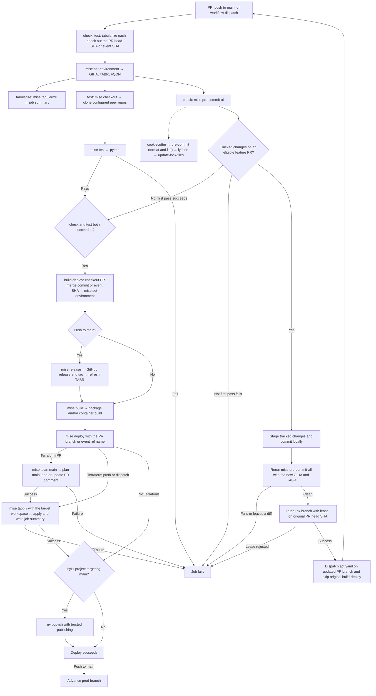

# Measles

Continuous [cookiecutter](https://github.com/cookiecutter/cookiecutter) featuring
[mise](https://github.com/jdx/mise).

```bash
cat <<'EOF' > .cookiecutter.yaml
default_context:
    languages: Node,Python
    python_dependencies:
        - django
        - gunicorn
EOF
mise use --global uv@latest
uv tool run cookiecutter --config-file .cookiecutter.yaml --no-input --overwrite-if-exists https://github.com/biobuddies/measles.git
mise trust --yes
mise install
mise pre-commit-all
mise test
```

## Autoformat Excludes

To exclude files from autoformatting and linting, add extended regular expressions
for relative paths from the repository root to `.config/autoformat-excludes` like:

```
^public/bundle\.min\.js$
^publickey\.asc$
```

## Jinja Templates

Templates live in `{{cookiecutter.dot}}/`, which renders to `.`: cookiecutter assumes templates
render into a codename folder, but measles renders into the repository root.

Each file ends with its final suffix, so editors offering one syntax highlighter pick the final
form's. An infix marks the template syntax:

- `.j2.` for regular Jinja2, such as `pyproject.j2.toml`
- `.hj.` for hash Jinja, such as `act.hj.yaml`, which hides Jinja in YAML comments so prettier
  can autoformat the template

Hash Jinja configuration, from `measles/__init__.py`:

```python
hash_jinja = {
    'block_end_string': '%#',
    'block_start_string': '#%',
    'comment_end_string': '*#',
    'comment_start_string': '#*',
    'lstrip_blocks': True,
    'trim_blocks': True,
    'variable_end_string': '}#',
    'variable_start_string': '#{',
}
```

## Workflow Tasks

`.github/workflows/act.yaml` runs these mise tasks, which can be overridden in `mise.toml`:

- `build` takes no arguments, so it suits environment-agnostic steps like most Python wheels and
  Docker images. Put environment-specific steps in `deploy`.
- `test` runs locally and on GitHub, so it suits unit and integration tests.
- `deploy` takes the environment: the pull request branch or `main`. Put environment-specific
  JavaScript And Markup (JAM) builds here, and start end-to-end tests that need a real hosted
  environment. Guard production-only steps with `[[ ${1-} == main ]]`.

## First GitHub Action Run

Until `main` has `.github/workflows/act.yaml`, rendering adds `TABR` to its `push`
triggers, so a bootstrap branch runs act before its pull request merges. Once `origin/main` has
the workflow, the next render drops that branch.

## GitHub Actions



## Agent Sandboxes

Set environment setup script to

```bash
grep -qs 'setup\.bash' .claude/hooks/session-start.sh || measles/.config/setup.bash
```

This accommodates Claude Code on the web's different single and multiple repository startups.
Always include measles in multiple repository sessions: they start in the parent directory,
where only this script can run setup.

TODO re-test on Codex Cloud, probably leveraging `.codex/setup.sh`
